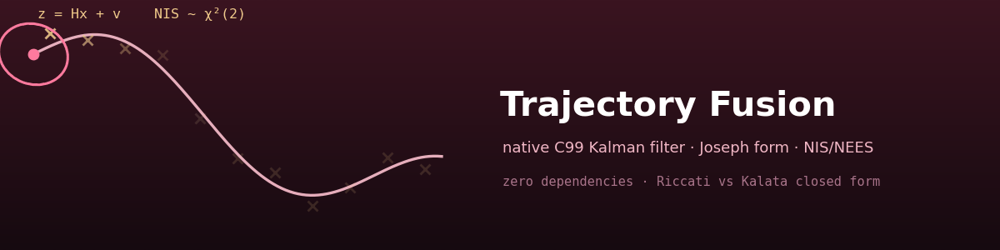
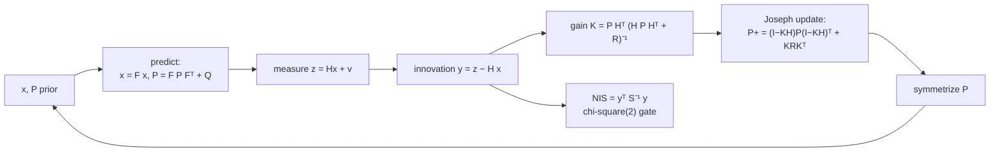

<div align="center">



# 🛰️ Trajectory Fusion

### Native C99 Kalman filter with serious covariance verification

**Joseph-form updates, chi-square consistency checks (NIS/NEES), and validation of
the iterated Riccati gain against the closed-form steady-state solution. No external
dependencies — the linear algebra, the RNG, the filter and the tests are all written
from scratch in C.**

[](https://github.com/khalil-work/trajectory-fusion-c/actions/workflows/ci.yml)
[](LICENSE)
[](src)
[](docs/verification.md)
[](tests)
[](https://github.com/khalil-work/trajectory-fusion-c/stargazers)
[](https://github.com/khalil-work/trajectory-fusion-c/commits)

[Homepage](https://khalil-work.github.io) · [Quick start](#-quick-start) · [Model](#-model-summary) · [Animation](#%EF%B8%8F-results-gallery) · [Metrics](#-metrics-real-numbers-from-the-committed-run) · [References](#-references)

</div>

---

## 🎯 Purpose and scope

Track a 2-D target that moves with (noisy) constant velocity from noisy position
measurements, and verify the implementation the way tracking engineers do:

| Check | Criterion |
| --- | --- |
| 🔬 **Innovation consistency** | NIS behaves as chi-square(2) |
| 📐 **Covariance correctness** | Monte-Carlo NEES average falls inside the chi-square(4N)/N interval |
| 🎯 **Steady-state correctness** | iterated Riccati gain equals the analytic alpha-beta (Kalata tracking-index) solution to machine precision |
| 0️⃣ **Zero-noise limit** | with Q = 0 and exact measurements the exact trajectory is recovered (error ~1e-15) |

> **Out of scope** (see [docs/verification.md](docs/verification.md)): EKF or any
> nonlinear model, maneuvering targets, multi-sensor fusion. The claims hold for the
> linear CV model with matched noise.

## 🧮 Model summary

State `x = [px, vx, py, vy]`, transition and measurement

```
F = [[1, dt, 0, 0],       H = [[1, 0, 0, 0],
     [0, 1,  0, 0],            [0, 0, 1, 0]],   R = diag(r, r)
     [0, 0, 1, dt],
     [0, 0, 0, 1 ]]
```

Process noise is the piecewise-white acceleration model
`Q_axis = sigma_a^2 [[dt^4/4, dt^3/2], [dt^3/2, dt^2]]`. The measurement update uses
the **Joseph form** `P+ = (I-KH) P- (I-KH)^T + K R K^T`, chosen because it strongly
reduces numerical loss of positive semi-definiteness relative to the compact form
`(I-KH)P-` — floating-point arithmetic gives no unconditional guarantee, and the
implementation additionally symmetrizes `P` after every step. Full derivations and
units: [docs/model.md](docs/model.md).

### Predict → update cycle



## ⚡ Quick start

```sh
# tests (the CI gate) -- the Makefile creates build/ as needed
make test

# build + run the demo (writes docs/results/trajectory.csv)
make demo

# regenerate all results (CSVs, plots, GIF, run_summary.json)
make results                            # needs python3 + matplotlib + pillow
```

The Makefile is the portable entry point (on Windows use `mingw32-make`). To build
the demo directly with gcc, create the output directory first:

```sh
mkdir -p build
gcc -std=c99 -Wall -Wextra -O2 src/kalman.c src/rng.c examples/traj_demo.c \
    -lm -o build/traj_demo
./build/traj_demo                       # Windows: build\traj_demo.exe
```

Build flags used and verified warning-free: `-std=c99 -Wall -Wextra -O2`.

<details>
<summary><b>🧱 Architecture</b></summary>

```
src/kalman.{c,h}    filter + fixed-size linalg core (4x4 / 2x2, no malloc)
src/rng.{c,h}       deterministic 64-bit LCG + Box-Muller sampling
tests/test_kalman.c assert-based C suite (~1.13M checks) -> `make test`
tests/test_wrapper.py  thin pytest wrapper around the compiled C binary
examples/traj_demo.c        noisy CV trajectory -> trajectory.csv
examples/run_verification.c NIS / Riccati / NEES-MC / zero-noise -> CSVs + metrics
examples/run_verification.py plots, GIF, run_summary.json (post-processing only)
docs/model.md docs/api.md docs/verification.md
docs/results/     committed outputs of one verified run
```

The algorithmic content is 100% C; Python only orchestrates plotting.

</details>

## ✅ Verification summary

- `make test` runs **1,131,438 scalar assertions** — a handful of test functions
  whose statistical loops generate most of the checks, not that many independent
  unit tests: linalg identities, hand-computed predict/update values,
  Joseph-vs-naive agreement, input validation (negative variance, NaN/Inf, dt ≤ 0,
  asymmetric P all rejected), long-run symmetry/positive-definiteness, steady state
  vs closed form, NIS, NEES Monte-Carlo, zero-noise limit. All pass.
- `build/run_verification` re-derives the statistical evidence and writes the
  committed CSVs; it exits non-zero if any bound is violated.
- `tests/test_wrapper.py` (pytest) merely re-runs the compiled binary.
- Chi-square bounds are exact (closed form for dof 2, incomplete-gamma inversion
  otherwise) and cross-checked at runtime — see `chi2_bounds_crosscheck` in
  `docs/results/run_summary.json`.

Details and limits: [docs/verification.md](docs/verification.md).

## 🔎 Limitations

Linear constant-velocity model with matched noise only; single 2-D position sensor
with diagonal `R`; fixed `dt`; no EKF. The demo's heuristic first-measurement
initialization inflates its early NIS/NEES (informational only — the gated checks
use exact model-matched initialization).

---

## 🎞️ Results gallery

<div align="center">

**▶ Watch covariance ellipses shrink around the trajectory:**


<sub>Provenance: rendered with Matplotlib/Pillow from `docs/results/trajectory.csv`,
written by the C program `examples/traj_demo.c` (gcc 16.2.0, `-std=c99 -O2`,
seed 20261018: dt = 0.5 s, 240 steps, sigma_a = 1.2 m/s², sigma_z = 3 m).
60 frames, one per 4th filter step; the red ellipse is the 2-sigma position
covariance P[px,py] from the same run. All plotted values come from the recorded
C simulation — a synthetic, model-generated benchmark trajectory — with no
hand-drawn or decorative elements.</sub>

</div>

### 📈 Metrics (real numbers from the committed run)

| Check | Result | Acceptance |
|---|---|---|
| Steady-state gain vs closed form | max error **2.94e-15** over all 8 entries (72 iterations, residual 5.5e-15) | < 1e-10 |
| NIS mean (200,000 steps, 2 dof) | **1.995980** | [1.95, 2.05] |
| NIS fraction in chi2_2 95% interval | **0.9500** | [0.945, 0.955] |
| NEES average, 1000 MC runs (4 dof) | **3.935397** | [3.826597, 4.177191] |
| NEES per-run fraction in chi2_4 95% interval | **0.946** | ~0.95 |
| Zero-noise recovery (400 steps) | pos err **0 m**, vel err **1.6e-15 m/s** | < 1e-8 / < 1e-6 |
| Demo position RMSE (2nd half) | 2.647 m (sigma_z = 3 m) | informational |

### 🖼️ Static figures & raw evidence

`docs/results/` holds `trajectory.csv`, `nis_long.csv`, `riccati.csv`,
`nees_mc.csv`, `verification_metrics.json`, `run_summary.json` and the plots
`trajectory.png`, `nis_nees.png`, `riccati_convergence.png`,
`covariance_ellipses.gif`.

## 📚 References

- Y. Bar-Shalom, X. R. Li, T. Kirubarajan — *Estimation with Applications to
  Tracking and Navigation* (theory of NIS/NEES consistency, Joseph form,
  steady-state alpha-beta filters).
- P. R. Kalata — *The tracking index: A generalized parameter for alpha-beta and
  alpha-beta-gamma target trackers*, IEEE Trans. Aerospace and Electronic Systems,
  1984.
- R. E. Kalman — *A New Approach to Linear Filtering and Prediction Problems*,
  Journal of Basic Engineering, 1960.
- G. H. Golub & C. F. Van Loan — *Matrix Computations* (numerical symmetry and
  Joseph-form stability context).

## 🔑 License

MIT — see [LICENSE](LICENSE). © 2026 KHALIL.

Calendar metadata: [date-record disclosure](docs/CALENDAR_HISTORY.md). Historical
calendar-record author dates are synthetic; original software commits and actual
committer dates are preserved.
